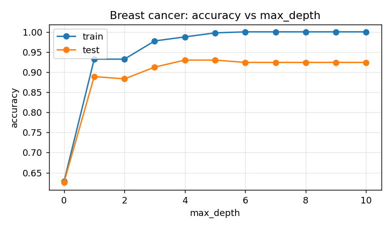
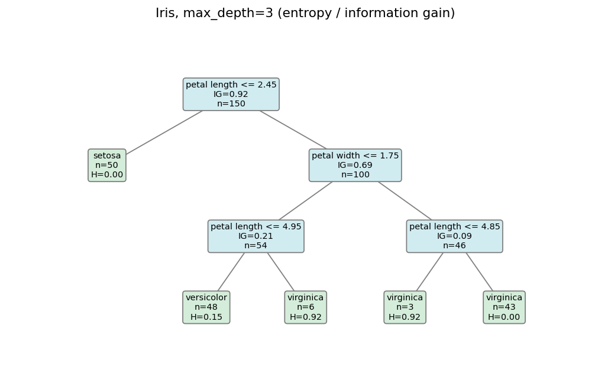

# Binary Decision Tree Classifier (Entropy & Information Gain)

**GitHub repository:** https://github.com/CestAshish/entropy-decision-tree

## 1. Project Overview

This project implements a binary decision tree classifier from scratch in Python using NumPy. The algorithm recursively partitions data at each node by finding a threshold that maximizes information gain based on Shannon entropy.

The implementation focuses on being clear, simple, and intuitive:
- A recursive binary tree structure (`Node` and `DecisionTreeClassifier`).
- Basic hyperparameters to control tree growth and prevent overfitting (`max_depth`, `min_samples_split`, `min_samples_leaf`, and `min_information_gain`).
- Model evaluation and prediction methods (`fit`, `predict`, `predict_proba`, `score`, and `feature_importances_`).
- Easy text-based and visual tree inspection (`export_text`, `export_graphviz`, `plot`).

---

## 2. Mathematical Background

### Shannon Entropy

Given a set of samples $S$ with class counts $c_1, c_2, \dots, c_K$ and total size $|S| = \sum c_k$, the probability of class $k$ is $p_k = c_k / |S|$. The Shannon entropy (in bits) is:

$$H(S) = -\sum_{k=1}^K p_k \log_2(p_k)$$

- $H(S) = 0$ when all samples belong to a single class (completely pure).
- $H(S) = 1$ when two classes are split 50/50.

### Information Gain

When splitting parent set $S$ into a left subset $S_L$ and right subset $S_R$ based on a feature threshold $x_j \le \theta$:

$$IG(S, S_L, S_R) = H(S) - \left( \frac{|S_L|}{|S|} H(S_L) + \frac{|S_R|}{|S|} H(S_R) \right)$$

The split with the largest information gain provides the greatest reduction in uncertainty.

---

## 3. Implementation Details

### Node Class
A lightweight node representation:
- `feature` and `threshold`: the splitting decision for internal nodes.
- `left` and `right`: child subtrees.
- `value`: class distribution at the node.
- `entropy` and `gain`: metrics stored for debugging and visualization.
- `prediction`: majority class index.
- `is_leaf`: returns true if the node is not split further.

### Tree Growth (Recursion)
The tree is built recursively using `_build_tree`:
1. Calculate the class distribution and entropy for the current node.
2. Check stopping criteria:
   - Max depth reached (`depth >= max_depth`).
   - Too few samples to split (`n_samples < min_samples_split`).
   - Node is already pure (`entropy == 0`).
3. If not stopping, scan every feature:
   - Sort unique values of the feature.
   - Test split thresholds placed at the midpoints between consecutive values: $\theta = \frac{v_i + v_{i+1}}{2}$.
   - Partition samples into left ($x \le \theta$) and right ($x > \theta$).
   - Check that both partitions have at least `min_samples_leaf` samples.
   - Calculate information gain.
4. If the best gain is greater than `min_information_gain`, assign `feature` and `threshold`, then recursively construct `left` and `right` subtrees. Otherwise, keep the node as a leaf.

### Prediction
To predict a new sample, we traverse down from the root:
- At each internal node, go left if $x[\text{feature}] \le \text{threshold}$, else go right.
- At a leaf, return the majority class label.

---

## 4. Hyperparameters for Tree Size

Four simple hyperparameters control tree complexity and prevent overfitting:

1. `max_depth`: Limits the maximum depth from the root.
2. `min_samples_split`: The minimum number of samples needed to attempt a split.
3. `min_samples_leaf`: The minimum number of samples each child must contain.
4. `min_information_gain`: The minimum gain needed to justify making a split.

### Accuracy vs. Depth on Breast Cancer

Evaluating the tree on a 70/30 train/test split of the Breast Cancer dataset illustrates how `max_depth` controls model capacity:

| max_depth | Train Accuracy | Test Accuracy |
|:---:|:---:|:---:|
| 0 | 0.628 | 0.626 |
| 1 | 0.932 | 0.889 |
| 2 | 0.932 | 0.883 |
| 3 | 0.977 | 0.912 |
| 4 | 0.987 | **0.930** |
| 5 | 0.997 | **0.930** |
| 6+ | 1.000 | 0.924 |



At low depth (1-2), the tree underfits. At depth 4-5, it reaches optimal test accuracy (93.0%). Deeper trees achieve 100% training accuracy but slightly overfit the training set.

---

## 5. Comparison with Scikit-Learn

We verified our implementation against `sklearn.tree.DecisionTreeClassifier(criterion="entropy")` on identical 70/30 train/test splits:

| Dataset | Setting | Ours (Test Acc / Depth / Leaves) | Scikit-Learn (Test Acc / Depth / Leaves) |
|---|---|---|---|
| Iris | `max_depth=2` | 0.956 / 2 / 3 | 0.956 / 2 / 3 |
| Iris | `max_depth=3` | 0.956 / 3 / 5 | 0.956 / 3 / 5 |
| Iris | `min_samples_leaf=5` | 0.911 / 4 / 6 | 0.911 / 4 / 6 |
| Breast Cancer | `max_depth=3` | 0.912 / 3 / 7 | 0.912 / 3 / 7 |
| Breast Cancer | `min_samples_split=10` | 0.930 / 5 / 11 | 0.930 / 5 / 11 |
| Breast Cancer | `min_samples_leaf=5` | 0.936 / 5 / 11 | 0.936 / 5 / 11 |

The trees produce identical splits, depths, leaf counts, and test accuracies across constrained configurations.

---

## 6. Tree Visualization

The tree can be inspected in text form via `export_text`:

```text
[petal length <= 2.450] (n=150, H=1.585, IG=0.918)
|-- yes: setosa (n=50, H=0.000) [50, 0, 0]
`-- no:  [petal width <= 1.750] (n=100, H=1.000, IG=0.690)
    |-- yes: [petal length <= 4.950] (n=54, H=0.445, IG=0.213)
    |   |-- yes: versicolor (n=48, H=0.146) [0, 47, 1]
    |   `-- no:  virginica (n=6, H=0.918) [0, 2, 4]
    `-- no:  [petal length <= 4.850] (n=46, H=0.151, IG=0.091)
        |-- yes: virginica (n=3, H=0.918) [0, 1, 2]
        `-- no:  virginica (n=43, H=0.000) [0, 0, 43]
```

Or graphically using Matplotlib:


